<div align="center">

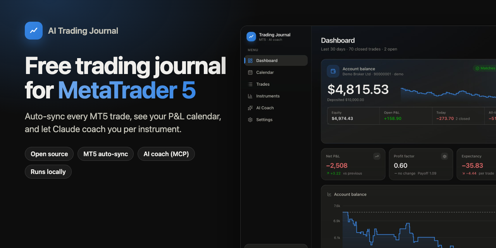

# AI Trading Journal: free, open-source trading journal for MT5 (MetaTrader 5)

**Every MetaTrader 5 trade syncs automatically. Review your P&L calendar, journal your setups and emotions, and get AI coaching from Claude on what's working and what's losing you money, instrument by instrument.**

Free forever · Open source (MIT) · Runs on your own computer · No subscription · No cloud account · Your data stays private

[](LICENSE)
[](#1-connect-metatrader-5)
[](#ai-coaching-with-claude)
[](https://www.python.org/)
[](web/)
[](CONTRIBUTING.md)

[**Website**](https://gillani-hello.github.io/ai-trading-journal/) ·
[**Demo video**](https://gillani-hello.github.io/ai-trading-journal/#demo) ·
[Features](#features) ·
[Quick start](#quick-start) ·
[Claude AI coach](#ai-coaching-with-claude) ·
[FAQ](#faq) ·
[Support ❤️](#support-the-project)

</div>

---

<p align="center">
  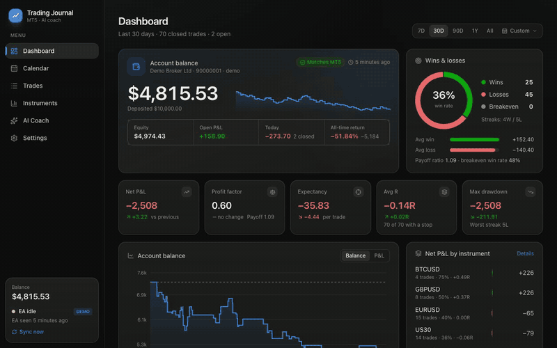
  <br>
  <sub>▶️ <a href="https://gillani-hello.github.io/ai-trading-journal/#demo">Watch the full-quality demo video</a> · <a href="docs/assets/demo.mp4">download MP4</a> · all screenshots use the built-in demo account</sub>
</p>

## Why this trading journal?

Most trading journals are paid web apps that want your broker login, or spreadsheets you stop updating after a week. **AI Trading Journal** is different:

- **It fills itself in.** A small, read-only MT5 Expert Advisor exports your full history and every new fill. Trades show up seconds after they close: partial closes, commissions, swaps, stop-loss changes and MFE/MAE all included.
- **It tells you why you're losing.** Built-in analytics flag revenge trading, overtrading, widened stops, early exits, sizing up after losses and losing sessions, and put a dollar cost on each.
- **It has a real AI coach.** Connect Claude through MCP and ask, in plain English (or by voice), *"What's my worst habit on gold this month?"* Claude reads your journal, writes a per-instrument review, and saves it into the app.
- **It's yours.** Everything is stored in a local SQLite file on your machine. No account and no upload; you can read the code.

## Features

### 📊 Dashboard with your live account balance
Balance, equity, open P&L, today's result and all-time return, reconciled against MT5 to the cent. Win rate, profit factor, expectancy, average R and max drawdown come with **comparisons to the previous period**. You also get the balance curve, daily P&L, and breakdowns by instrument and session. Pick **7D, 30D, 90D, 1Y or All**, or any **custom date range**.

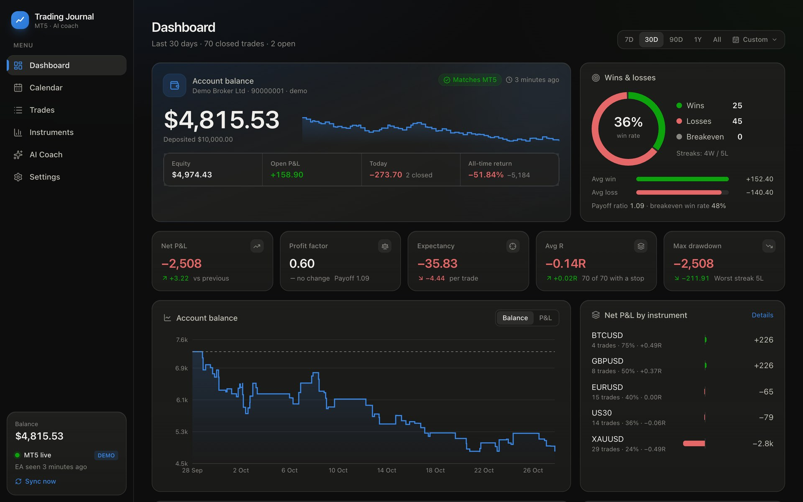

<details><summary>Custom date range picker and full dashboard</summary>

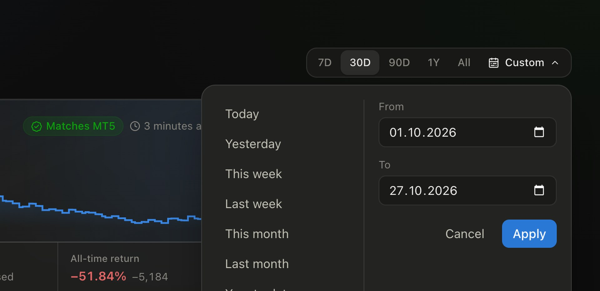
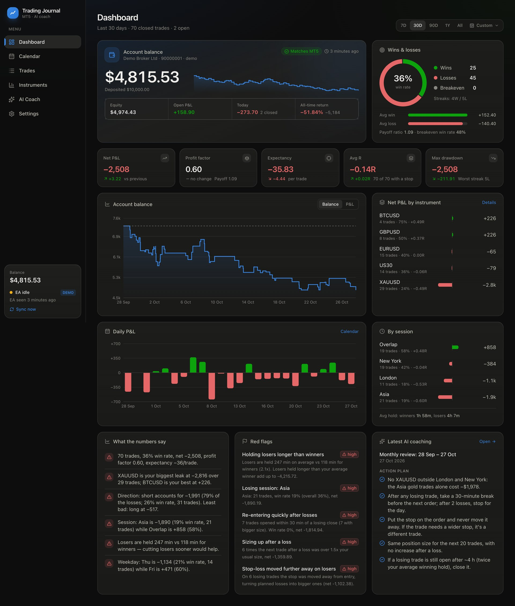

</details>

### 📅 P&L calendar and daily journal
Every day is shaded by its result, with the trade count and win rate, plus weekly totals. Click a day to see its trades and write your **pre-session plan, post-session review and mood**.

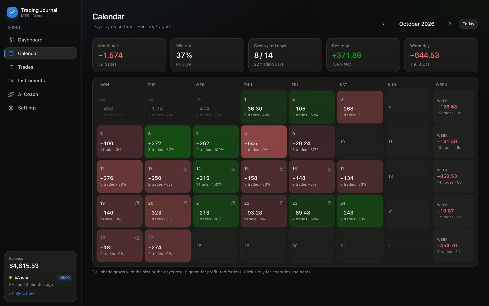
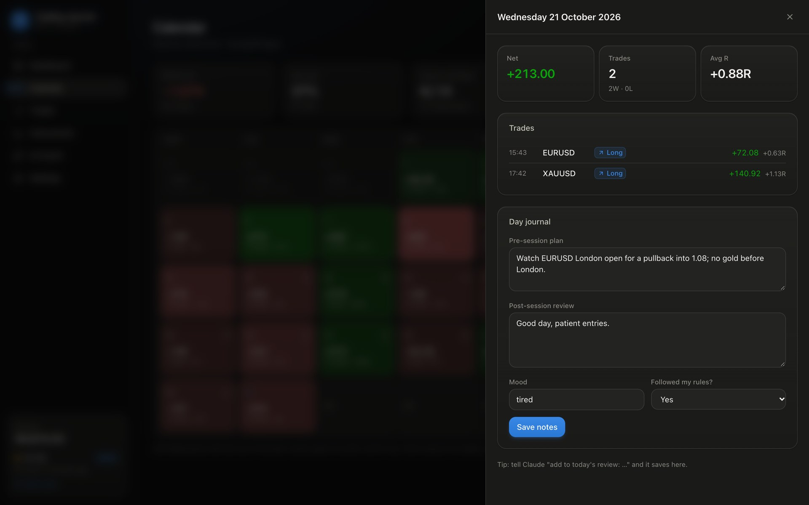

### 🧾 Every trade, fully journaled
- **Trades table:** filter by instrument, side, outcome, session, setup, emotion, mistake or source, search your notes, and sort any column.
- **Trade page:** entry and exit, the stop that defines 1R (and whether you added it late or widened it), R-multiple, holding time, session, every MT5 deal, and a **price-excursion bar** showing how much of the move you kept.
- **Journal on every trade:** setup, emotions, mistakes, a 1–5 rating, "followed my plan?", notes, and **chart screenshots** (drag, drop or paste).

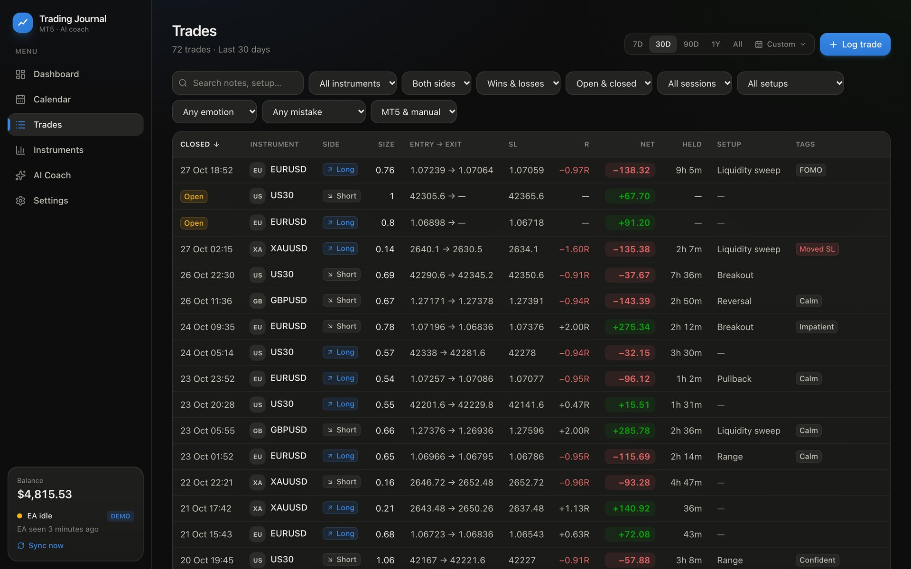
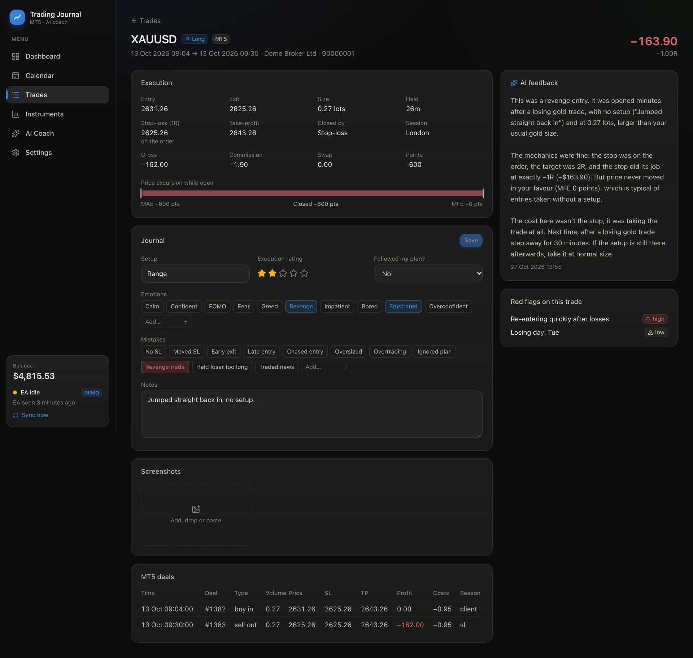

### 🎯 Per-instrument analytics
Each symbol gets a verdict (**edge**, **leaking**, **breakeven** or **too few trades**), its own equity curve, and breakdowns by session, weekday, direction, setup, exit type, hold time, emotion and mistake. Plain-English insights come with it, e.g. *"XAUUSD: Asia session accounts for −$1,978 (0% win rate) while Overlap is +$46."* Broker suffixes like `EURUSD.m`, `XAUUSD+` and `#US30` are merged automatically.

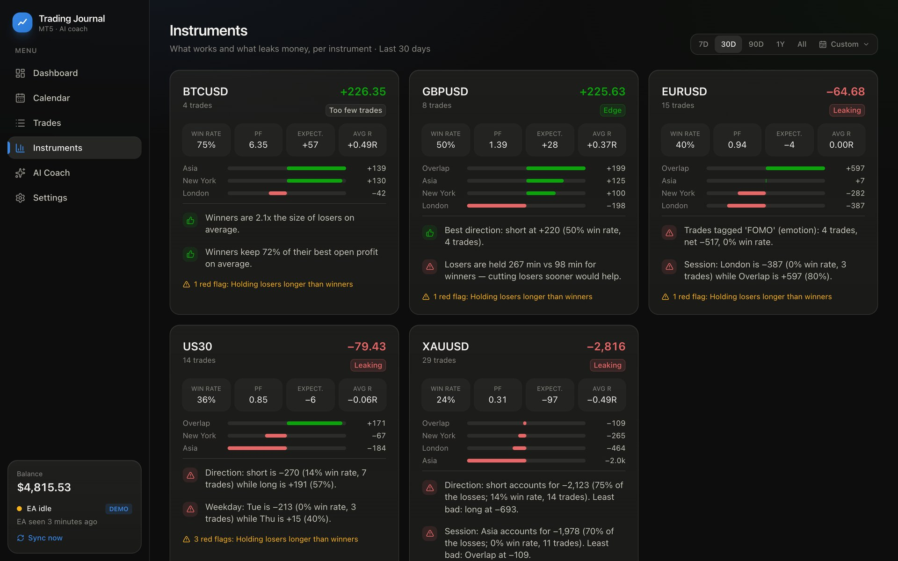

<details><summary>Instrument deep dive (XAUUSD)</summary>

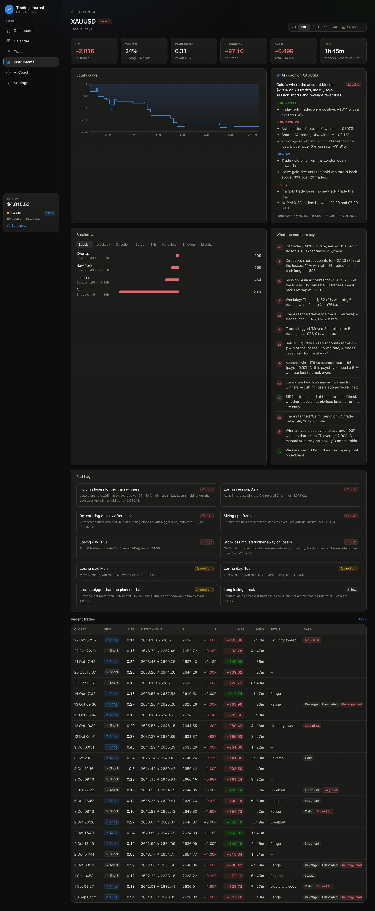

</details>

### 🚩 Behavioural red flags, with a dollar cost
| Flag | What it catches |
|---|---|
| Revenge trading | New trades opened within N minutes of a losing close, especially at a bigger size |
| Overtrading | Trades beyond your daily limit |
| No stop / stop added late | Positions opened unprotected, even if you add a stop afterwards (common on mobile) |
| Stop widened | Stops moved further from entry on losing trades |
| Loss beyond plan | Losses bigger than 1R |
| Holding losers | Losers held much longer than winners |
| Early exits | Winners that kept less than 40% of their best open profit |
| Sizing up after a loss | The next trade after a loss is much bigger than usual |
| Losing sessions and weekdays | Times of day or days of the week that consistently lose |

### 🤖 AI coach (Claude via MCP)
Weekly, monthly, per-instrument and per-trade reviews: strengths, weaknesses, psychology, a concrete action plan, and if/then rules for each instrument. Each review is backed by your journal's numbers and checked against your own written trading rules. [How it works ↓](#ai-coaching-with-claude)

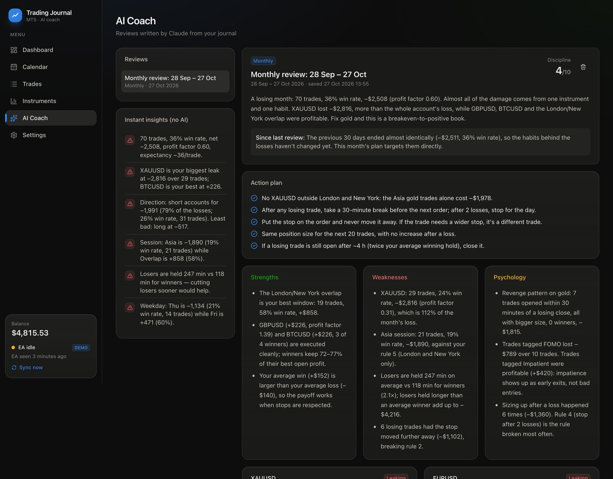

<details><summary>Full AI coach review (all instruments)</summary>

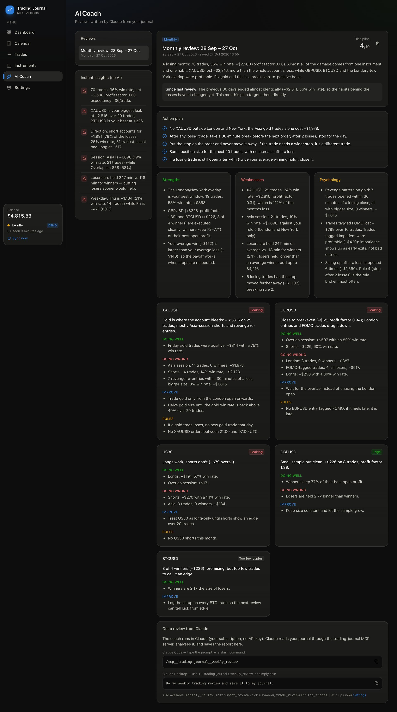

</details>

### More
- **Dictate trades** from other brokers ("short NAS100 at 20150, out at 20080, +$700") and Claude logs them, with duplicate detection against MT5.
- **Starts automatically at login** (macOS) and syncs in the background.
- **Demo mode** with 200+ realistic trades, so you can try everything before connecting a live account.
- **Accurate maths:** deals are grouped per MT5 position, partial closes are volume-weighted, netting reversals are split, broker server time (incl. New York-close DST) is converted to your timezone, and balances are reconciled against MT5.

## How it works

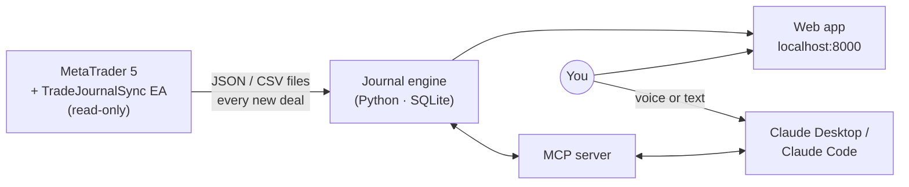

1. **The EA** runs on any MT5 chart. It never places, changes or closes trades. It writes your account, deals, symbols, open positions and price excursions to MT5's shared `Common/Files/TradeJournal/` folder.
2. **The journal** watches that folder, rebuilds trades from deals, and computes the statistics, behaviour flags and insights.
3. **The web app** shows it all. **The MCP server** gives Claude 16 tools to read the journal, add notes, log trades and save reviews.

## Quick start

**You need:**
- [uv](https://docs.astral.sh/uv/getting-started/installation/), which installs Python 3.13 for you
- [Node.js 20+](https://nodejs.org/)
- MetaTrader 5
- [Claude Desktop](https://claude.ai/download) for AI coaching (optional; it uses your Claude subscription, no API key)

```bash
git clone https://github.com/gillani-hello/ai-trading-journal.git
cd ai-trading-journal
uv sync                                   # Python dependencies
cd web && npm install && npm run build && cd ..   # web app
uv run tj serve                           # → http://127.0.0.1:8000
```

**Try it first with demo data** (kept separate from your real journal):

```bash
uv run tj seed-demo
uv run tj serve --demo
```

### 1. Connect MetaTrader 5

```bash
uv run tj install-ea
```

This copies `mt5/TradeJournalSync.mq5` into your terminal's `MQL5/Experts/TradeJournal/` folder and compiles it with your MetaEditor. Then, in MT5:

1. Open **Navigator › Expert Advisors › TradeJournal**, find **TradeJournalSync**, and drag it onto **any one chart**. Click **OK**.
2. Leave that chart open. Your full history is imported straight away, and new trades arrive within seconds.

The EA contains no trading code, so *Algo Trading* can stay off. If your terminal won't start EAs at all, tick *Allow Algo Trading* in its properties. If `install-ea` can't find or compile it, do it by hand: in MT5 choose **File › Open Data Folder**, put the `.mq5` file into `MQL5/Experts/`, open it in MetaEditor and press **F7**.

| Platform | Status |
|---|---|
| **macOS** (MetaQuotes' MT5 app for Mac) | ✅ Tested end to end, including automatic EA compile and start at login |
| **Windows** | ✅ Supported (MT5 under `%APPDATA%\MetaQuotes\Terminal`). Please [report issues](https://github.com/gillani-hello/ai-trading-journal/issues) |
| **Linux** (MT5 under Wine: `~/.wine` or `~/.mt5`) | ✅ Supported. Please [report issues](https://github.com/gillani-hello/ai-trading-journal/issues) |

Folders are found automatically. Set `TJ_MT5_DIR` to the EA's export folder to override that.

### 2. Keep it running (optional, macOS)

```bash
uv run tj install-service     # start at login, restart if it crashes
uv run tj uninstall-service   # undo
```

On Windows, `install-service` prints a ready-to-run `schtasks` command; on Linux it prints the command to use in a systemd user service.

## AI coaching with Claude

The coach runs inside **Claude Desktop** or **Claude Code** on your own Claude plan, with no API key and no extra cost. Claude talks to the journal through the [Model Context Protocol (MCP)](https://modelcontextprotocol.io/).

### Connect (one time)

```bash
uv run tj mcp-config --write-desktop   # adds the journal to Claude Desktop (backs up your config)
```

Then quit Claude Desktop completely (⌘Q / Exit) and reopen it. Ask *"How many trades are in my journal?"* to check, and choose **Always allow** when Claude asks to use the trading-journal tools.

**Claude Code:** run the `claude mcp add …` command that `uv run tj mcp-config` prints.

### Talk to your journal

| You say | Claude does |
|---|---|
| *"My last gold trade was a breakout. I felt FOMO and entered late. 2/5."* | Adds setup, emotion, mistake and rating to the MT5 trade (`annotate_trade`) |
| *"Log a trade from my other broker: short NAS100 at 20150, out at 20080, 1 lot, +$700."* | Logs a manual trade and warns about duplicates (`log_trade`) |
| *"How am I doing on EURUSD this month by session?"* | Pulls stats and breakdowns (`get_performance`) |
| *"What's my worst habit and what is it costing me?"* | Reads the behaviour flags with their cost (`get_behavior_report`) |
| *"Today's review: stopped after two losses like my plan says. Mood calm."* | Saves the day's note on the calendar (`write_day_note`) |
| *"Save my trading rules: max 1% risk, stop on every order, no gold in Asia."* | Stores your rules; every review then checks you against them |

Speak instead of typing with Claude Desktop's voice input or your OS dictation.

### Coaching reviews (prompts)

In Claude Desktop click **+ › trading-journal** and pick a prompt. In Claude Code type `/mcp__trading-journal__weekly_review`. Or just ask: *"Do my weekly trading review."*

| Prompt | What you get |
|---|---|
| `weekly_review` / `monthly_review` | Every instrument you traded: what works, what leaks money, rules to adopt, and a 3–5 point action plan. Progress is checked against the previous review. |
| `instrument_review` | A 90-day deep dive on one symbol (e.g. XAUUSD) |
| `trade_review` | A critique of one trade (entry, stop, exit, size), attached to the trade |
| `log_trades` | A guided session for dictating several trades |

Reviews are saved to the **AI Coach** page, and each instrument's section also appears on that instrument's page. Claude works from numbers the journal computes deterministically (win rate, R, sessions, flags, your notes), so its advice is grounded in your own data.

<details><summary>All 16 MCP tools</summary>

`log_trade` · `annotate_trade` · `find_trades` · `get_trade` · `get_performance` · `get_instrument_breakdown` · `get_calendar` · `get_behavior_report` · `get_coaching_context` · `save_ai_report` · `save_trade_feedback` · `write_day_note` · `list_tags` · `set_trading_rules` · `sync_mt5` · `delete_trade`

</details>

> The AI coach reviews your process and discipline from your own statistics. It does not give investment advice or tell you which trades to take.

## Commands

| Command | Purpose |
|---|---|
| `uv run tj serve [--demo] [--port 8000]` | Web app + MT5 folder watcher |
| `uv run tj mcp [--demo]` | MCP server on stdio (Claude launches this) |
| `uv run tj sync [--force]` | Import now; `--force` rebuilds every trade |
| `uv run tj install-ea` | Copy + compile the MT5 Expert Advisor |
| `uv run tj mcp-config [--write-desktop]` | Connect Claude Desktop / Claude Code |
| `uv run tj install-service` / `uninstall-service` | Start at login (macOS) |
| `uv run tj seed-demo` | Rebuild the demo journal in `demo-data/` |

## Settings worth checking

- **Display timezone:** the calendar groups trades by close time in this zone.
- **Broker server time:** *Auto* handles "New York close" brokers (UTC+2 in winter, UTC+3 in summer). Choose *Fixed* if your broker's clock never changes.
- **Sessions:** defined in UTC hours.
- **Revenge window, max trades per day, early-exit threshold:** these tune the red flags.
- **My trading rules:** Claude holds you to these in every review.

Your data lives in `data/journal.db` (SQLite) and `data/screenshots/`. Back up that folder and you've backed up your journal.

## FAQ

<details><summary><b>Is this trading journal really free?</b></summary>

Yes. It's MIT-licensed open source, with no subscription, trial or paywall. The AI coach uses the Claude plan you already have.
</details>

<details><summary><b>Does it work with any MT5 broker or prop-firm account?</b></summary>

Yes. The EA reads the terminal's own account history, so it works with any broker or prop-firm account you can open in MetaTrader 5, on demo, live or challenge accounts. Hedging and netting accounts are both supported.
</details>

<details><summary><b>Does the Expert Advisor place or modify trades?</b></summary>

No. It only reads history and writes files to MT5's shared folder. The source is in <a href="mt5/TradeJournalSync.mq5"><code>mt5/TradeJournalSync.mq5</code></a>.
</details>

<details><summary><b>Does it support MetaTrader 4 (MT4)?</b></summary>

Not yet. The EA is written in MQL5. An MQL4 version is on the roadmap, and contributions are welcome.
</details>

<details><summary><b>Where is my data stored? Is it sent anywhere?</b></summary>

Everything stays on your computer in a local SQLite database. Nothing is uploaded. When you use the AI coach, Claude reads the journal through the local MCP server, on your own Claude account.
</details>

<details><summary><b>Do I need an Anthropic/Claude API key?</b></summary>

No. It works through Claude Desktop or Claude Code on your normal Claude plan.
</details>

<details><summary><b>Can I log trades that aren't on MT5 (other brokers, crypto exchanges)?</b></summary>

Yes. Use "Log trade" in the web app, or just tell Claude about the trade.
</details>

<details><summary><b>Is this a free alternative to paid trading journals?</b></summary>

That's the goal: an open-source trading journal you run yourself. It offers automatic MT5 import, a P&L calendar, a per-trade journal with screenshots, analytics and an AI coach, without a monthly fee.
</details>

## Roadmap

- [ ] MetaTrader 4 (MQL4) export EA
- [ ] Light theme
- [ ] CSV import from other platforms
- [ ] Multi-currency account totals
- [ ] Docker image

Ideas and pull requests are very welcome. See [CONTRIBUTING.md](CONTRIBUTING.md).

## Support the project

If this journal helps your trading, you can support its development with crypto ❤️

| Asset | Network | Address |
|---|---|---|
| **USDT** | Ethereum (ERC-20) | `0xaA441f66aFC5381E2410EB47d798D95b5E58113f` |
| **USDT** | Tron (TRC-20) | `TT2JSFi6kXRD8pcsstGL8WaGAdPRVKyWUQ` |
| **ETH** | Ethereum (ERC-20) | `0xaA441f66aFC5381E2410EB47d798D95b5E58113f` |

<table>
  <tr>
    <td align="center"><br><sub>USDT (ERC-20) &amp; ETH</sub></td>
    <td align="center"><br><sub>USDT (TRC-20)</sub></td>
  </tr>
</table>

Always double-check the network before sending: ERC-20 and TRC-20 are different networks. A ⭐ on GitHub also helps other traders find the project.

## Contributing

Bug reports, feature ideas and pull requests are welcome. See [CONTRIBUTING.md](CONTRIBUTING.md) for the development setup (`uv run pytest`, `npm run dev`).

## License and disclaimer

[MIT](LICENSE) © Syed Muhammad Ali Hassan Gillani.

This software is for journaling and education only. It is **not financial advice**, and trading carries a high risk of loss. MetaTrader is a trademark of MetaQuotes Ltd; Claude is a trademark of Anthropic. This project isn't affiliated with either.

<sub>Keywords: trading journal, MT5 trading journal, MetaTrader 5 journal, free trading journal, open source trading journal, forex trading journal, gold XAUUSD journal, trade log, trading diary, trading performance analytics, AI trading coach, Claude MCP, prop firm journal.</sub>
